# AZ Data Organizer: Releases

This repository holds the **installers** for AZ Data Organizer, a Windows desktop app that sorts UK
contact data into separate files by area code and postcode. The source code is private.

**Download:** get the latest `AZDataOrganizer-Setup-x.y.z.exe` from [Releases](../../releases/latest).

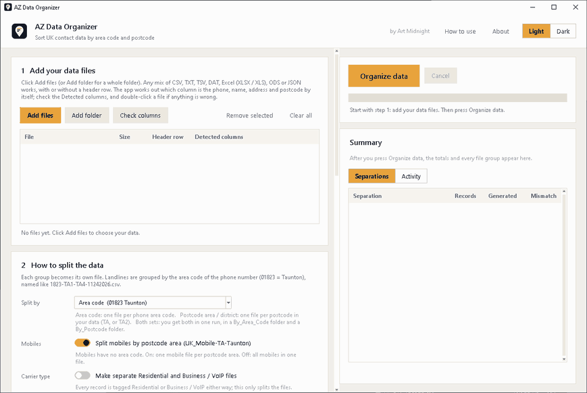

## What it does
- Reads CSV, TXT, TSV, DAT, Excel (XLSX / XLS), ODS and JSON files, with or without a header row.
  It finds the phone, name, address and postcode columns by itself.
- Splits landlines by the area code of the phone number (`1823-TA1-TA4.csv`) or by the postcode in the
  data (`TA`, `TA2`), or writes both sets in one run.
- Fills missing details with a mark (default `none`). Keeps every full postcode in the data, and
  gives landlines with no postcode one for their area code.
- Removes duplicate numbers across all files, or keeps them, or writes both versions.
- Writes the phone as raw, `0`, `44` or `+44`, in CSV, TXT, TSV, XLSX, XLS or JSON, using header
  presets you can edit.
- Adds the source file name to every row, so you can see which list each lead came from.
- Gives a detailed summary of every file group, with light and dark themes and a built-in
  *How to use* guide.

## Screenshots
| Detected columns, with or without headers | Output options |
|---|---|
| 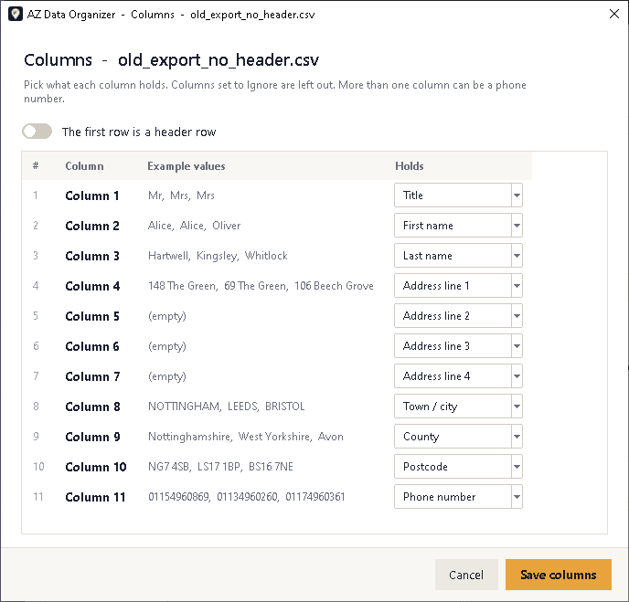 | 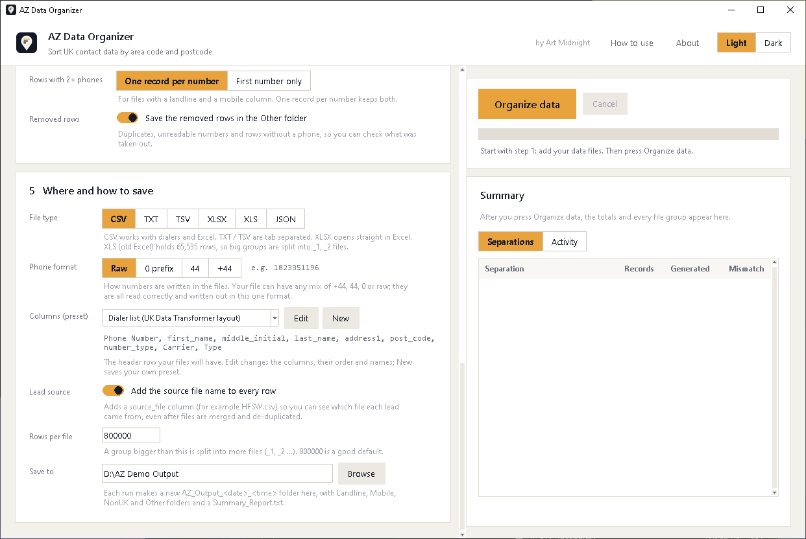 |

| Review all files: every file grouped by layout, problems flagged |
|---|
| 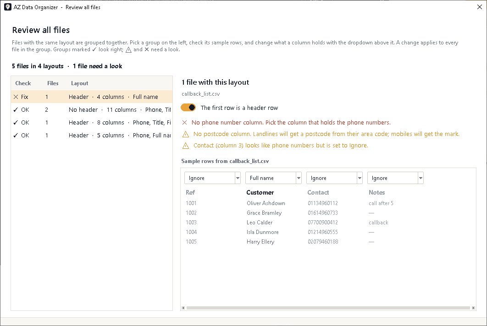 |

| Summary after a run | Dark theme |
|---|---|
| 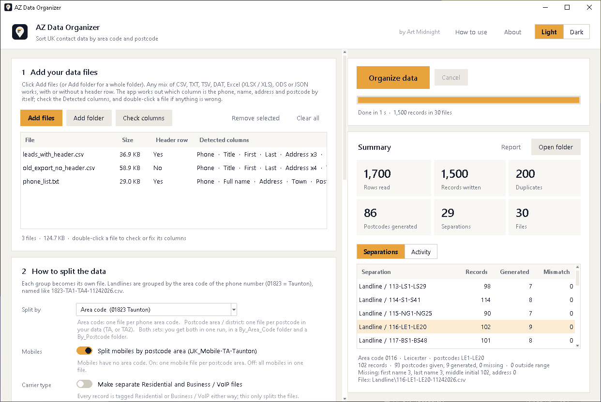 | 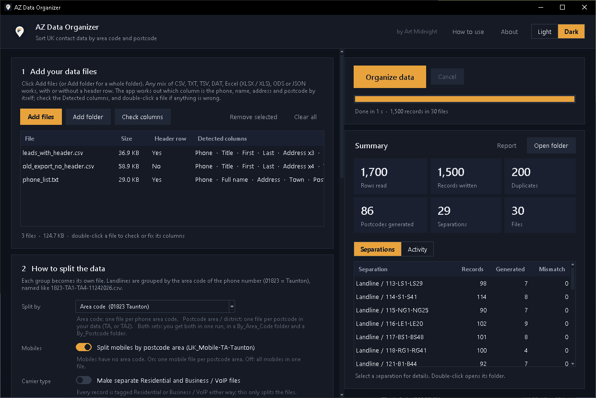 |

*Screenshots use made-up demo data. The phone numbers are from Ofcom's ranges reserved for TV and
drama.*

Installed copies check this repository when they start. When there is a newer release they show
**Update now** / **Update later**. Update now downloads the installer, checks its SHA-256 checksum,
and upgrades the app in place.

## Getting a licence
The app needs a licence key from Art Midnight.
1. Install the app and open it. It shows your computer's **Machine ID** (for example `7F3A-91C2-55D0-1B8E`).
2. Email the Machine ID to **devartmidnight@gmail.com** (the *Email it* button does this for you).
3. Paste the licence key you get back and click **Activate**.

One licence can cover several computers (seats). The app reminds you before a licence ends, keeps
working for a short grace period after it ends, and then asks for a renewed key.

## Permission required
AZ Data Organizer is proprietary software. You may install and use it only with permission from
**Art Midnight**. See [LICENSE.txt](LICENSE.txt).

## Support the developer
AZ Data Organizer is made by **Art Midnight**. If it saves you time, a tip keeps updates coming. Thank you!

☕ **[Buy me a coffee](https://buymeacoffee.com/artmidnight)**

The same QR codes are in the app: click **☕ Support** at the top of the window (or **About → Support the developer**),
with a **Save QR image** button.

<table>
  <tr>
    <td align="center"><a href="https://buymeacoffee.com/artmidnight">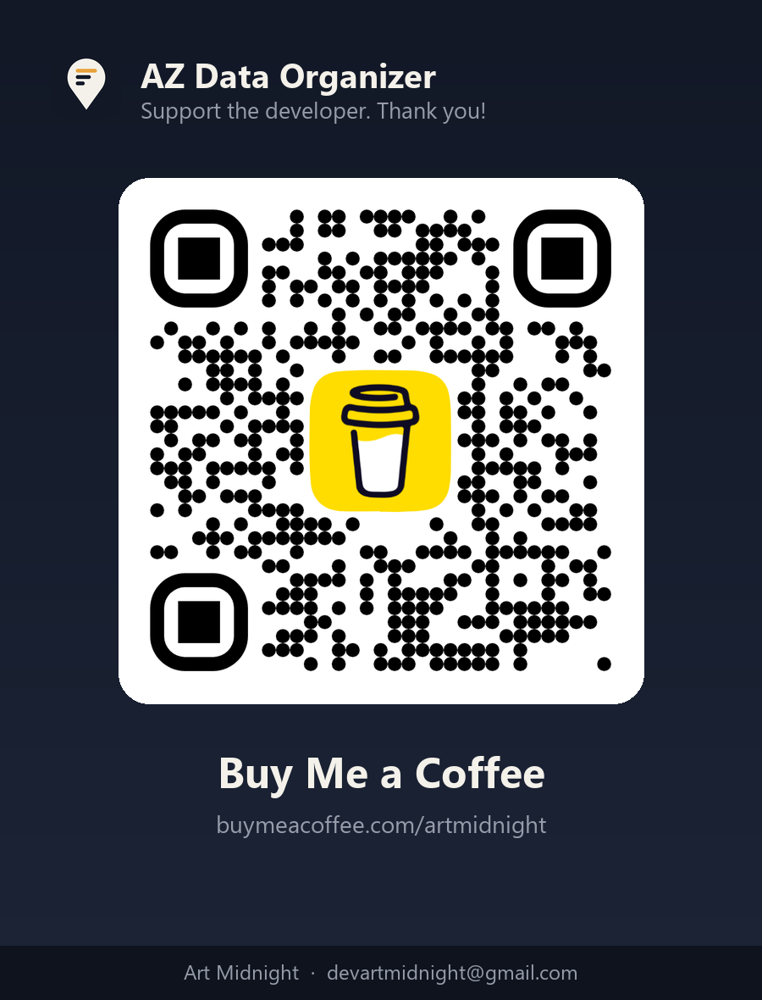</a> <b>Buy Me a Coffee</b></td>
    <td align="center">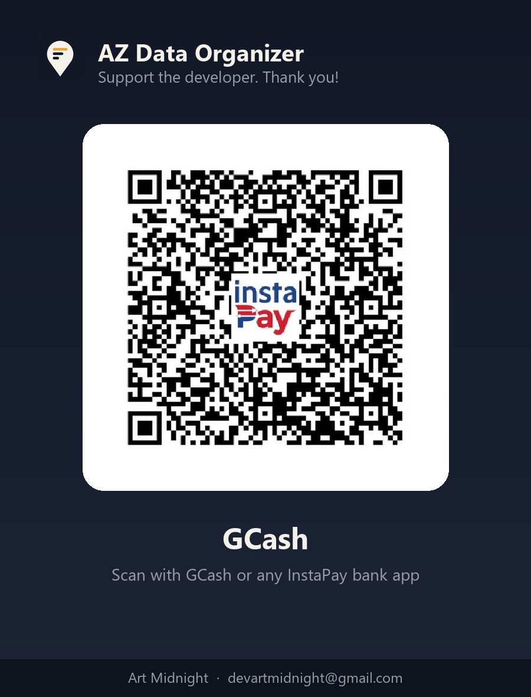 <b>GCash</b></td>
    <td align="center">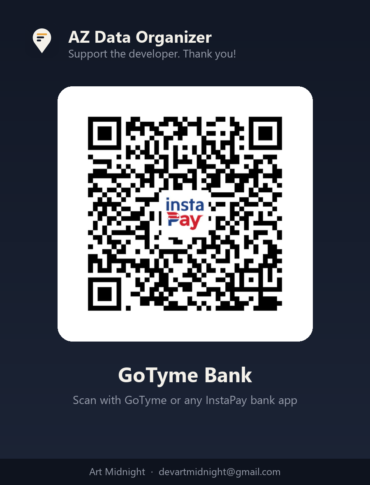 <b>GoTyme Bank</b></td>
    <td align="center">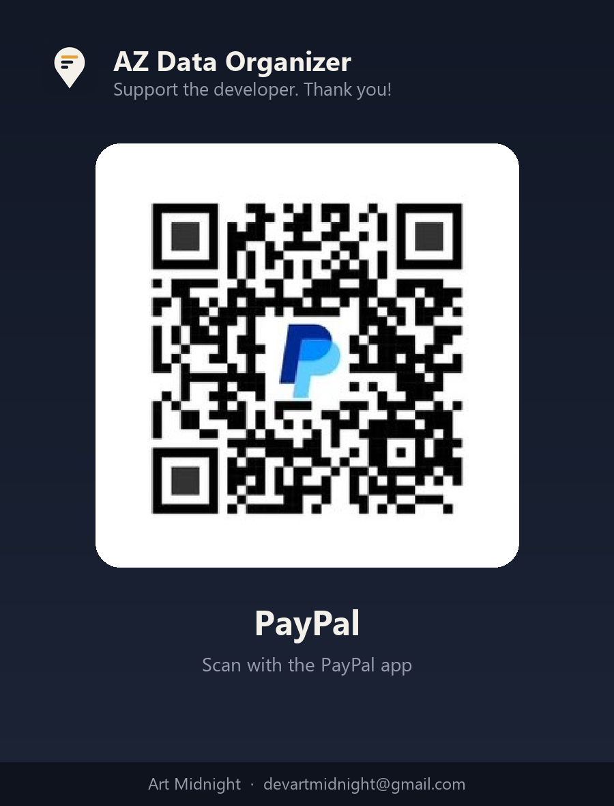 <b>PayPal</b></td>
    <td align="center">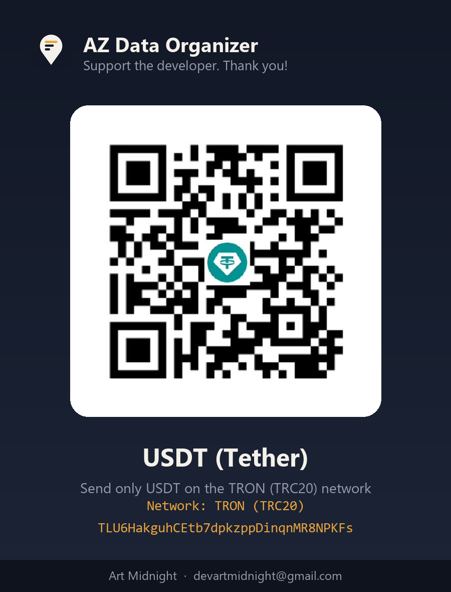 <b>USDT (TRON, TRC20)</b></td>
  </tr>
</table>

USDT address (TRON network, TRC20 only): `TLU6HakguhCEtb7dpkzppDinqnMR8NPKFs`
Send only USDT on the TRON (TRC20) network. Other coins or networks will be lost.

Only use these QR codes from the app or this page.

## Contact and support
Questions, permission to use the app, or support: **[devartmidnight@gmail.com](mailto:devartmidnight@gmail.com)**

Want a **custom app or automation** for your business or personal use? Email the same address and tell me what you need.
